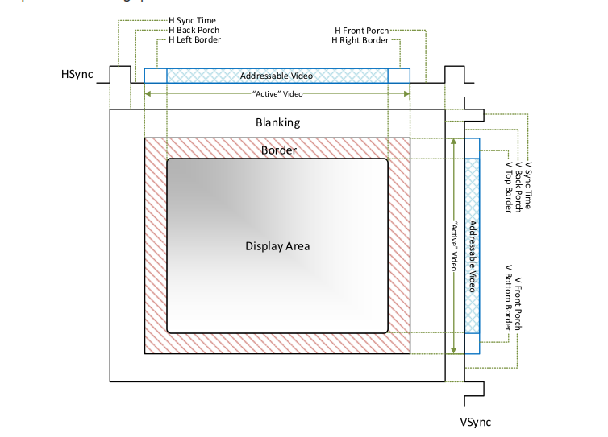

# VGA Display Controller Architecture Plan (640x480 @ 60 Hz)

## 1. System Overview

The VGA controller is structured into a clean, hierarchical 3-tier modular hardware architecture:

```
┌───────────────────────────────── vga_top ─────────────────────────────────┐
│                                                                           │
│                       Internal Interconnect Buses                         │
│                       - pixel_x  : std_logic_vector(9 downto 0)           │
│                       - pixel_y  : std_logic_vector(9 downto 0)           │
│                       - video_on : std_logic                              │
│                                                                           │
│   ┌───────────────────────┐             ┌─────────────────────────────┐   │
│   │     vga_sync_gen      │             │       pixel_generator       │   │
│   │                       │             │                             │   │
clk ───▶                    │             │                             │   │
rst ───▶  - h_counter (800) │             │  - Blanking blanker         │   │
    │     - v_counter (525) │             │  - Test patterns & bars     │   │
    │     - sync pulses     │             │  - Geometric shapes         │   │
    │                       │             │                             │   │
    │              pixel_x  ─────────────▶│                             │   │
    │              pixel_y  ─────────────▶│                             │   │
    │             video_on  ─────────────▶│                             │   │
    │                       │             │                             │   │
    │                hsync  ────────────────────────────────────────────────▶ HSYNC
    │                vsync  ────────────────────────────────────────────────▶ VSYNC
    │                       │             │                         red ────▶ RED   (4-bit)
    │                       │             │                       green ────▶ GREEN (4-bit)
    │                       │             │                        blue ────▶ BLUE  (4-bit)
    └───────────────────────┘             └─────────────────────────────┘   │
│                                                                           │
└───────────────────────────────────────────────────────────────────────────┘
```

---

## 2. Timing Specification (VGA 640x480 @ 60 Hz)



### What the Diagram Shows:
- **Active / Addressable Video (Center Canvas)**: The visible $640 \times 480$ screen area. Only here is `video_on = '1'` and RGB colors allowed.
- **Front Porch (Right / Bottom)**: A small quiet period (16 pixels / 10 lines) after active video.
- **Sync Pulse (HSync / VSync)**: The low pulse (96 pixels / 2 lines) that commands the beam to snap back (retrace) to the start.
- **Back Porch (Left / Top)**: The settling margin (48 pixels / 33 lines) before the next active scan line starts.
- **Blanking**: The entire border/retrace region where electron beams are cut off (`video_on = '0'`, RGB driven to pure black).

- **Pixel Clock**: 25.175 MHz ($\approx 25.000\text{ MHz}$, $T_{clk} = 40\text{ ns}$).

### Horizontal Scanline Timing (Pixels / Clock Cycles)
- **Visible Active Display ($H_{disp}$)**: 640 pixels ($0 \le h < 640$)
- **Front Porch ($H_{fp}$)**: 16 pixels ($640 \le h < 656$)
- **Sync Pulse ($H_{sync}$)**: 96 pixels ($656 \le h \le 751$) — Active Low (`'0'`)
- **Back Porch ($H_{bp}$)**: 48 pixels ($752 \le h < 800$)
- **Total Horizontal Line ($H_{max}$)**: **800 pixels** (Counter resets at 799)

### Vertical Frame Timing (Lines)
- **Visible Active Display ($V_{disp}$)**: 480 lines ($0 \le v < 480$)
- **Front Porch ($V_{fp}$)**: 10 lines ($480 \le v < 490$)
- **Sync Pulse ($V_{sync}$)**: 2 lines ($490 \le v \le 491$) — Active Low (`'0'`)
- **Back Porch ($V_{bp}$)**: 33 lines ($492 \le v < 525$)
- **Total Vertical Frame ($V_{max}$)**: **525 lines** (Counter resets at 524)

---

## 3. Module Breakdown & Roadmap

### Module 1: `rtl/vga_sync_gen.vhd` (The Master Sync Generator)
- Two 10-bit synchronous counters: `h_count_reg` (0..799) and `v_count_reg` (0..524).
- Registered glitch-free `hsync` and `vsync` outputs.
- Combinational or registered `video_on` signal (`1` when $h < 640$ and $v < 480$).
- Direct output of coordinate buses `pixel_x` and `pixel_y`.

### Module 2: `tb/tb_vga_sync_gen.vhd` (Timing Verification Lab)
- Self-checking testbench in GHDL.
- Validates that HSYNC pulse duration is exactly 96 clock cycles.
- Validates that VSYNC pulse duration is exactly 2 complete horizontal scanlines.

### Module 3: `rtl/pixel_generator.vhd` (Color & Pattern Generator)
- Pure combinational/pipelined color engine.
- Strict blanking enforcement: forces `(red, green, blue) = "0000"` when `video_on = '0'`.
- Sub-modes:
  - Mode 0: 8 vertical color bars (White, Yellow, Cyan, Green, Magenta, Red, Blue, Black).
  - Mode 1: Center test grid / crosshair.
  - Mode 2: Dynamic bouncing square.

### Module 4: `rtl/vga_top.vhd` (Top-Level Integration)
- Structural VHDL mapping `vga_sync_gen` to `pixel_generator`.
- Final pin mappings ready for simulation or physical FPGA synthesis constraints.

### Module 5: `tb/tb_vga_framegrabber.vhd` (Visual PPM Export)
- Simulates 1 full frame ($640 \times 480$ pixels).
- Writes RGB data to a `.ppm` image file using VHDL `std.textio`.
- Lets you open and view the simulated image directly in Ubuntu image viewers!
