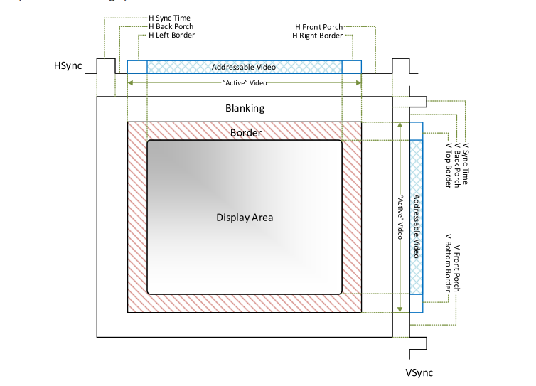

# VGA Raster Timing & Frame Architecture

## 📌 Understanding the VGA Raster Scan

The diagram above illustrates the classical **VGA raster scanning frame structure** used by monitors to construct an image line-by-line from top-left to bottom-right:

### 1. The Regions in Both Dimensions (Horizontal & Vertical)

| Region | Horizontal Line (Pixels) | Vertical Frame (Lines) | Role in Display Hardware |
| :--- | :---: | :---: | :--- |
| **Addressable / Active Video** | **640** pixels | **480** lines | The visible canvas. This is the **only** region where `video_on = '1'` and RGB pixel color signals are emitted. |
| **Front Porch** | **16** pixels | **10** lines | Small guard band after the visible video before the sync pulse fires. |
| **Sync Pulse (HSync / VSync)** | **96** pixels | **2** lines | Synchronization trigger telling the monitor deflection coils to fly back to the opposite side (retrace). Active-low (`'0'`). |
| **Back Porch** | **48** pixels | **33** lines | Settling interval allowing beam amplifiers to stabilize before the next active video scan begins. |
| **Blanking Interval** | Porches + Sync ($160$ px) | Porches + Sync ($45$ lines) | The beam retrace dead-time. RGB color lines **must be forced to black (`0000`)** to prevent retrace lines on screen. |

---

### 2. Full Frame Totals

$$\text{Total Horizontal Line} = 640 + 16 + 96 + 48 = \mathbf{800\text{ pixels}}$$
$$\text{Total Vertical Frame} = 480 + 10 + 2 + 33 = \mathbf{525\text{ lines}}$$
$$\text{Pixel Clock Frequency} = 800 \times 525 \times 60\text{ Hz} \approx \mathbf{25.175\text{ MHz}}$$
